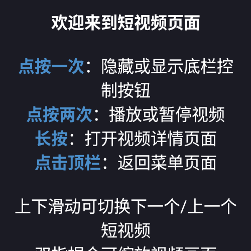
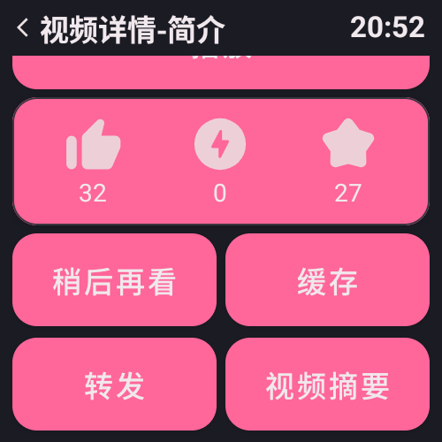
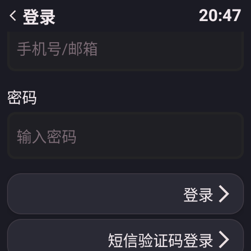
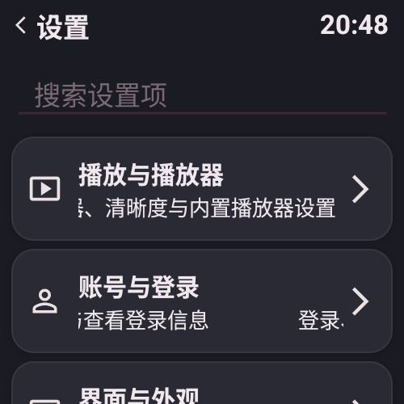
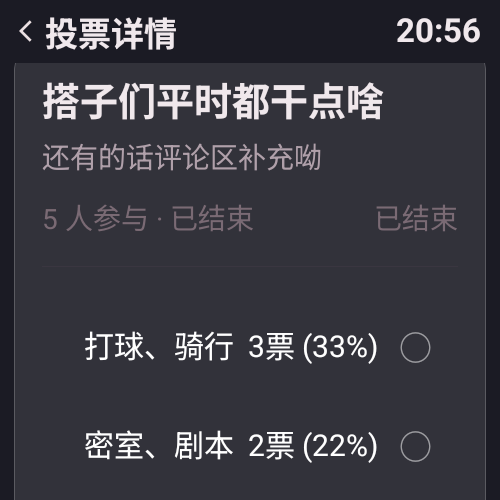

# RE:哔哩终端

轻量的第三方 B 站 Android 客户端，基于哔哩终端 BiliClient 2.7.0 的改版分支

---

## 项目简介

这是一个**极其轻量级**的 **B 站 Android 客户端**，名字来源于原神中的「虚空终端」。本项目是 [哔哩终端 BiliClient](https://gitee.com/RobinNotBad/BiliClient) 停更后的改版分支，基于原版 2.7.0 开发，在保留原版轻量、流畅、低配设备友好的特性的同时，对代码进行了**全面 Kotlin 重构**，并持续新增了大量功能。

---

## 界面预览

  
  
  
   
  
  
  

---

## 功能特性

### 界面与主题

| 功能 | 说明 |
| --- | --- |
| 多主题系统 | 内置 B 站粉、知乎蓝、爱奇艺绿、紫色空灵、五彩斑斓、经典灰、经典终端共 7 套主题，可在设置中自由切换，即时生效（显示名以 `ui/appearance/ColorScheme.kt` 的 `getThemeDisplayName()` 为准） |
| 经典终端主题 | 复刻老版哔哩终端的黑色背景 + 半透明卡片 + 暖白文字外观，并作为新安装用户的默认主题 |
| 独立「外观设置」页 | 主题配色、卡片圆角、自定义字体集中管理，并已接入设置项搜索 |
| 卡片圆角两档 | 「方角」还原原项目圆角，「圆角」为本项目主题化后的较大圆角，切换即时生效 |
| 自定义字体 | 可从文件管理器选择 TTF / OTF / TTC 字体文件并全局应用，提供常驻的「恢复系统字体」按钮 |
| 设置界面重构 | 统一渲染体系、新增设置项搜索、设置 key 集中管理、返回图标统一 |
| 菜单设置双分区 | 已启用 / 未启用分区展示，支持拖拽移入未启用区 |
| 「我的」页面自定义 | 功能入口支持自定义排序与分区（主列表 / 更多列表），入口不再依赖接口加载，含未登录引导与登录凭证状态迁移 |
| 教程系统重构 | 注册表 + Kotlin DSL 驱动，按页面集中触发，同页多篇串行展示不再层层叠栈 |
| 关于页改版 | 开源协议与借鉴项目拆到独立页面，开发者信息改为数据驱动展示 |
| 新版启动页 | 全新现代风格的启动页面 |
| 长按返回主页 | 长按顶部标题栏可快速返回主页：普通页面打开菜单列表、视频详情页关闭所有详情页；设置里可选「不响应 / 仅视频详情页 / 全部页面」 |
| 长按操作面板 | 长按视频卡片/会话/评论等条目弹出统一的操作面板，替代原先藏在角落的入口 |
| 界面自适应 | 界面大小/边距/Density 全局缩放（0.25~5 倍），圆屏适配、横屏模式、文字跑马灯、加载渐入渐出动画 |

### 播放体验

| 功能 | 说明 |
| --- | --- |
| 后台/熄屏继续播放 | 退到后台或熄屏时继续播放，并在通知栏挂出遥控（独立播放前台服务 + MediaSession） |
| 短视频 | 支持浏览 B 站短视频内容，列表预加载提升流畅度 |
| 虚拟合集 | 本地缓存/收藏夹里同一文件夹的视频组成合集，支持选集切换与自动联播；收藏夹视频另有「点击即播」开关（默认关，点卡片进视频详情页） |
| 详情页内联播放 | 视频详情页内直接播放（带弹幕） |
| 播放器增强 | 时间点标记、强制高分辨率选项；另有长按倍速、双击快进快退、洗脑循环、听视频模式、视频缩放、解码方式、音频输出等内置播放器设置 |
| 左右滑动控制进度 | 可选开关，开启后在视频区域左右滑动调节进度并显示实时悬浮提示 |
| 视频摘要 | 视频详情页一键查看 AI 生成的视频内容总结（需登录） |
| 番剧与多 P 进度 | 观看进度全链路上报（新增心跳接口并校验多 P cid），番剧、多 P 视频可正常续播 |
| 播放内核统一 | 普通播放器与短视频播放器合并到同一套播放核心，减少重复实现并修复长按后手势失效 |
| 一键三连 | 设置中开启后，在视频详情页长按点赞按钮即可一键三连 |
| 互动视频调试 | 播放互动视频时可显示调试按钮，查看与修改变量 |
| 软件旋屏兼容 | 少数手表系统强制旋屏显示不全时，改用软件旋屏渲染 |
| 播放失败如实提示 | 播放失败会明确提示并提供重试，不再伪装成「播放完毕」 |

### 下载与缓存

| 功能 | 说明 |
| --- | --- |
| 多线程高速下载 | 内置多线程下载引擎，分片加速下载视频、音频与图片 |
| DASH 合并 | 自动将 DASH 分离的音视频流合并为 MP4（含 faststart 优化） |
| 下载可靠性 | 分片完整性校验、单分片自动重试、动态分片；下载失败不再误删已下载好的视频 |
| 视频文件夹管理 | 自定义分类、新建/重命名/删除文件夹与多选批量操作 |
| 缓存增强 | 快捷缓存、默认缓存画质（4K/2K/1080P/720P/480P/360P/仅音频） |
| 下载任务管理 | 下载列表暂停/继续/重试、长按删除任务、底部总进度条与实时刷新、屏幕常亮 |
| 缓存分P与通用下载 | 本地合集分P选播/删除，APK/更新包下载完自动安装、退出清理残留 |
| 下载服务增强 | 并行下载（1~10）、通知栏进度与完成通知、自动下附件（封面/字幕/弹幕）、防重复 |

### 评论与互动

| 功能 | 说明 |
| --- | --- |
| 评论带图 | 支持发送带图评论（客户端不再要求大会员，能否发送以服务端判定为准），选图后即时回显，图片上传兼容 GIF / PNG |
| 表情评论 | 支持表情插入评论 |
| 动态配图与表情 | 发布与查看动态支持配图、表情渲染，转发动态可引用原作者 |
| 动态投票 | 支持动态中的投票内容与投票详情页 |
| 动态管理 | 长按自己的动态可编辑、置顶/取消置顶、删除；发布支持插入话题与 5 档定时发布 |
| 话题广场 | 话题广场与话题动态列表，动态正文里的话题可点进话题页 |
| 评论管理 | 评论可点赞/取消、长按自己的评论置顶或删除；楼中楼支持按时间/热度排序 |
| 私信增强 | 会话长按置顶/删除/查看主页；私信可发送图片（仅图片，暂不支持表情） |
| 列表长按管理 | 稍后再看、收藏夹、历史记录支持长按（两次）快速删除 |

### 搜索与发现

| 功能 | 说明 |
| --- | --- |
| 热搜榜 | 一键查看 B 站实时热搜 |
| 搜索设置 | 搜索建议开关、默认搜索内容、搜索类别排序，另有独立的搜索排序方式页 |
| 番剧搜索 | 搜索结果新增「番剧」标签页，可在设置中单独开关 |
| 发现入口 | 推荐、热门、排行榜、热门时间线、追番、直播推荐等 |

### 账号与安全

| 功能 | 说明 |
| --- | --- |
| 账号切换 | 支持多账号快速切换，账号列表长按删除、底部添加新账号 |
| 登录增强 | 二维码/密码/短信三种登录方式，密码 RSA 加密传输，集成极验验证码处理风控 |
| 登录态维护 | access_token 自动刷新；启动时不再因网络波动清掉登录态 |
| 隐私模式 | 不记录视频观看状态 |
| 个人资料编辑 | 修改个人描述/签名、换头像、改昵称/生日/性别，均提示等待审核 |
| 登录信息与记录 | 查看登录信息、账号切换页，以及登录记录 / 硬币变化记录 / 经验变化记录 |

### 文章与内容

| 功能 | 说明 |
| --- | --- |
| 文章富文本 | 专栏/图文支持标题、引用、代码块、分割线等富文本渲染 |
| 文章详情完善 | 修复误跳动态详情，正文加载与点赞/投币/收藏、cv 号、日期显示 |
| 图文动态直取 | 图文/Opus 动态优先走 detail 接口解析，失败再回退抓取页面 |
| 收藏夹页增强 | 用户收藏夹列表与文件夹管理，显示收藏数量与上限 |
| 历史与稍后再看 | 历史记录、稍后再看列表，支持长按删除；稍后再看可按「全部 / 未看完」筛选并一键清除已看完 |
| 收藏夹管理 | 用户收藏夹列表与文件夹管理，显示收藏数量与上限；支持按收藏时间/播放量/投稿时间排序与多选批量管理 |
| 视频笔记 | 视频笔记列表与详情（仅查看，暂不支持在客户端内撰写） |
| 追番与合集 | 关注番剧列表、番剧详情、合集与用户系列页 |

### 更新与工程

| 功能 | 说明 |
| --- | --- |
| 后台自动检查更新 | 启动应用时自动检查新版本，更新包下载完自动安装、安装完成按版本号自动解除强制更新 |
| 更新日志分页 | 关于页历史更新日志按版本横向分页查看，不再叠成一长条；升级后首次启动自动展示当版日志 |
| 公告页 | 更新公告统一由「提醒弹窗 + 公告页」两处合并为一处，不再重复打扰；公告统一走本分支自建服务器，上游原版公告由服务端拉取、维护者逐条审核后透传并标注来源，下拉可刷新 |
| 反馈与建议 | 应用内直接向维护者提交反馈（问题/建议/内容/性能分类，可附带设备信息），无需登录第三方平台 |
| 教程管理 | 一键通过所有教程、清除教程进度、重置页面滑动引导 |
| 高性能模式 | 自动检测设备性能等级，优化运行体验（实验性） |
| 版本与 CI 自检 | 版本号一致性校验任务接入 `check`，CI 编译与单元测试自检、发版附 APK 校验值 |
| 双版本发行 | 同一份代码出两个包：普通版与**共存版**（包名带 `.coexist`，可与普通版同时安装）；两版名字相同（RE:哔哩终端），靠图标区分，数据隔离、各自更新 |
| 崩溃反馈 | 崩溃后显示崩溃页，可手动把堆栈上传到自建接口 |
| 推荐去重 | 自动过滤已经显示过的推荐视频 |

### 稳定性与安全

| 功能 | 说明 |
| --- | --- |
| 安全加固 | 网络重定向改为域名白名单、移除 trust-all 死代码、登录凭证不再明文进日志、关闭应用备份、收敛组件对外导出面、开发者测试页移出正式包 |
| 稳定性修复 | 修复多处数组越界与平台 API 误用闪退、后台异常杀进程、消息中心加载卡死、列表刷新卡住、评论区世代竞态、下载失败误删文件等问题 |
| 设备兼容 | 运行时探测系统 View 方法并自动降级，兼容裁掉系统方法的设备；圆屏适配改为按控件真实父容器类型设置布局参数 |

### 反馈与隐私

| 功能 | 说明 |
| --- | --- |
| 应用内反馈 | 设置 → 关于与帮助 → 反馈与统计中可直接提交反馈，支持选择分类、附加设备信息与当前视频号（默认关闭） |
| 匿名使用统计 | 仅统计匿名安装数与日活，用于了解使用规模；使用随机本地 ID，**与账号无关、不采集 IP 与 Cookie**，卸载重装即换新 ID，可在设置中关闭 |
| 崩溃自动上报 | 崩溃页给出报错编号，可在独立进程自动上报堆栈（可关闭），也可手动上传 |
| 隐私说明 | 关于页提供隐私说明与同意确认，与上述三个开关的默认值保持一致 |

## 附：说明

- 本文档由源码逐文件审查整理而来，力求一个按钮、一个手势、一个隐藏功能都不遗漏。
- 个别"占位/未实现"功能（如私信表情发送、收藏夹公开/私密开关等）已如实标注。
- 「功能特性」栏目中的新增条目以应用内更新日志（`app/src/main/res/values/strings.xml` 的 `update_log_current` / `update_history_log`）与源码核对为准；技术细节与历史台账见 [docs/README.md](docs/README.md)（现用文档 `docs/`，已过期的审查报告在 `docs/archive/`）。

---

## 系统要求

- **Android 4.4（API 19）及以上**

原版哔哩终端曾支持 Android 4.0.4；本分支经 Kotlin 重构后一度要求 Android 7.0，26.10.10 起一路下调到 **Android 4.4**（Wear OS 手表上普遍可用的最低版本）。再往下的 Android 4.3 及更早版本请使用原版哔哩终端或手表版。

> Android 4.4~6.0（API 19~23）的兼容结论全部来自静态审计、依赖元数据与 lint，**尚未在真机上验证过**；遇到问题欢迎反馈。

---

## 与原项目的关系（重要）

**RE:哔哩终端是 [哔哩终端 BiliClient](https://gitee.com/RobinNotBad/BiliClient) 的改版分支（fork），不是原项目，也并非官方续作。**

- 原版哔哩终端已经**宣布停更**，本分支在 2.7.0 的基础上继续开发。
- 本项目由社区/个人维护，**与 RobinNotBad 及原开发团队没有任何关系**，遇到任何问题请**不要**向原项目团队反馈。
- 原版项目版权归 RobinNotBad 及原开发团队所有；本项目沿用原版开源协议（代码 GPL v3、界面 CC BY-NC-SA）。

---

## 构建与开发

`clone` 本项目，导入到你的 IDE 中进行开发、构建。

./gradlew.bat :app:assembleRelease   # 编译正式包（R8 + 资源压缩，ABI 分包 arm64-v8a / armeabi-v7a / x86 + universal 通用包）
./gradlew.bat :app:testStandardDebugUnitTest   # 单元测试（普通版；共存版用 testCoexistDebugUnitTest）

> 所有改动**直接提交到 `main`**（26.10.22 起不再按类型分 `feat/*`、`fix/*` 分支），需要评审或合并上游时从 `main` 开 PR。欢迎提交 pr。

---

## 致谢

- 本项目借鉴了 [WearBili](https://github.com/SpaceXC/WearBili) 和 [腕上哔哩](https://github.com/luern0313/WristBilibili) 的部分开源代码和它们收集的部分 API，界面曾使用 WearBili 的布局（现已重做）。
- 本次版本开发过程中，参考了第三方 [BiliTerminal](https://github.com/PianoEthan/BiliTerminal) 仓库（本地参考目录 `BiliTerminal`）的实现，包括但不限于**评论带图发送**、更新机制等功能的实现思路，特此感谢该仓库作者。
- 番剧「播放来源」的**选源交互**与第三方弹幕接入的思路参考了 [Kazumi](https://github.com/Predidit/Kazumi)，感谢其作者的开源工作（同样以 GPL v3 开源）。本项目**未包含** Kazumi 的源码，相关功能只在可选的构建期注入里生效，公开构建不含这部分实现。

> 除此之外本项目与其他第三方 B 站浏览软件无任何关系，谢绝在无关评论区提及终端，谢谢喵。

---

## 联系

- 唯一官网：[biliterminal.zsapp.asia](https://biliterminal.zsapp.asia/)
- QQ 交流群：1129816758

---

## 免责声明（重要）

**本项目是典型的 "vibe coding" 产物**——即由开发者描述需求、AI 编写代码、仅做粗略验证的 AI 辅助编程项目。

- 代码大量由 AI 生成，可能存在逻辑漏洞、隐藏 bug、不规范实现，甚至 AI "幻觉"出来的假功能。
- 项目**不提供任何形式的稳定性、可靠性保证**，**使用风险自负**。数据（登录、收藏、缓存等）请自行做好备份。
- 遇到 bug 请提 issue 或反馈给本分支的维护者，**不要**去找原版哔哩终端开发组。
- 请以「玩具 / 实验项目」的心态看待它，快乐使用就好。
